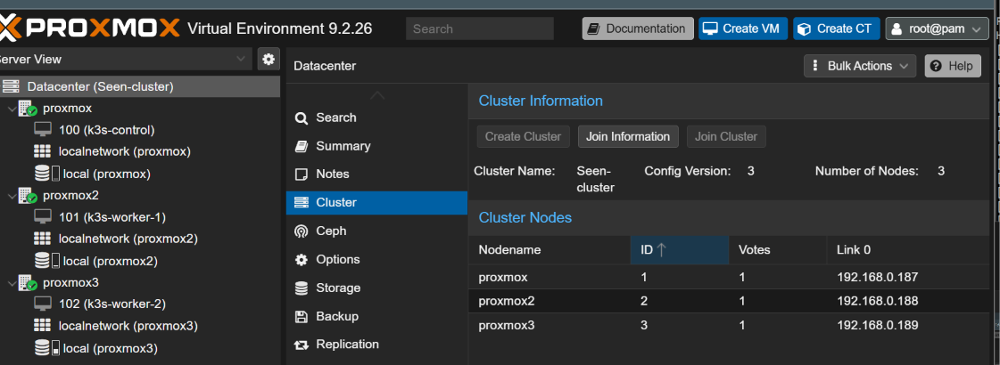
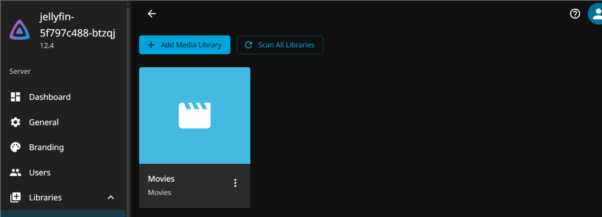

# Building a Production-Grade Kubernetes Homelab from Scratch

A fully operational Kubernetes homelab built on a single PC, managed entirely 
via GitOps with Flux CD. This documents exactly how I built it step by step.


---

## What I built

A production-grade Kubernetes cluster running on Proxmox with full GitOps, 
monitoring, databases, and ingress — all on a single PC at home. Every app 
is deployed automatically from this git repository. No manual kubectl commands 
in production.

## Physical Infrastructure

### Proxmox Cluster — Seen-cluster
Expanded from a single machine to a 3-node Proxmox cluster (one k3s VM per node, so losing a node only takes out one piece of Kubernetes):

| Node | IP | Role | VMs |
|------|----|------|-----|
| proxmox (node 1) | 192.168.0.187 | Primary | k3s-control |
| proxmox2 (node 2) | 192.168.0.188 | Secondary | k3s-worker-1 |
| proxmox3 (node 3) | 192.168.0.189 | Tertiary | k3s-worker-2 |

All nodes run Proxmox VE 9.2 on the no-subscription repository. Three nodes give the
cluster real quorum: any one node can go down and the other two keep it running.



### External Access
- Domain: abdullaahyaseen.com
- DNS managed through Cloudflare
- Cloudflare Tunnel running as a systemd service for secure external access — no open ports, home IP never exposed
- Tailscale (tailnet `tail9966c9.ts.net`) for private remote access to homelab apps — tailnet devices only, valid HTTPS certs

---

## Stack

| Layer | Technology | Why |
|-------|-----------|-----|
| Hypervisor | Proxmox VE | Type 1 hypervisor, runs 3 VMs on one PC |
| Kubernetes | K3S | Lightweight K8s, installs in one command |
| Networking | Cilium CNI | eBPF-based, used by Google and AWS in production |
| GitOps | Flux CD | Watches GitHub, deploys changes automatically |
| Ingress | Nginx | Routes traffic to apps by hostname |
| Monitoring | Grafana + Prometheus | Industry standard observability stack |
| Databases | CloudNativePG | Enterprise PostgreSQL operator for Kubernetes |

---

## Step 1 — Install Proxmox

Downloaded and flashed Proxmox VE to a USB drive, installed it directly on 
bare metal replacing the existing OS. Proxmox turns one physical PC into a 
hypervisor capable of running multiple virtual machines simultaneously.
abdullaah019/homelab
After installation, expanded the storage by removing the default LVM partition 
and reclaiming the full disk space for VM storage.

---

## Step 2 — Create 3 Ubuntu VMs

Created 3 Ubuntu Server 22.04 VMs inside Proxmox:

- `k3s-control` — 2 cores, 4GB RAM, 20GB disk (control plane)
- `k3s-worker-1` — 2 cores, 5GB RAM, 40GB disk (worker node)
- `k3s-worker-2` — 2 cores, 5GB RAM, 40GB disk (worker node)

> **Lessons learned:**
> - Each Proxmox host has ~7.6GB RAM, so VM memory is sized to leave the host room to run.
>   The workers originally had 7GB each on one host, which overcommitted it.
> - The Ubuntu installer only allocates about half the disk to the root volume by default.
>   Expand it to the full disk so nodes don't hit disk pressure and start evicting pods:
>
> ```bash
> sudo lvextend -r -l +100%FREE /dev/ubuntu-vg/ubuntu-lv
> ```

Each VM was configured with OpenSSH enabled so they could be managed remotely 
from a Windows machine.

---

## Step 3 — Install K3S and form the cluster

Installed K3S on the control plane:

```bash
curl -sfL https://get.k3s.io | sh -
```

Got the node token from the control plane and joined both workers:

```bash
curl -sfL https://get.k3s.io | K3S_URL=https://192.168.0.88:6443 K3S_TOKEN=<token> sh -s - agent
```

Verified all 3 nodes were ready:

```bash
sudo kubectl get nodes
```

---

## Step 4 — Set up GitOps with Flux CD

Installed Flux CD CLI and bootstrapped it against a new GitHub repository. 
From this point forward every app is deployed by pushing YAML to GitHub — 
Flux detects the change and applies it automatically.

```bash
flux bootstrap github \
  --owner=abdullaah019 \
  --repository=homelab \
  --branch=main \
  --path=clusters/my-cluster \
  --personal
```

---

## Step 5 — Deploy applications via GitOps

Every app follows the same pattern — create a namespace, HelmRepository, 
and HelmRelease YAML, push to GitHub, Flux deploys it.

### Apps deployed

| App | Namespace | What it does |
|-----|-----------|--------------|
| Forgejo | forgejo | Self-hosted git server |
| Homepage | homepage | Live cluster dashboard |
| Grafana + Prometheus | monitoring | Metrics, dashboards, alerting |
| Uptime Kuma | uptime-kuma | Uptime monitoring + Telegram alerts |
| CloudNativePG | cloudnativepg | PostgreSQL operator for Kubernetes |
| Stremio | stremio | Media streaming server + web player (LAN + Tailscale) |
| Jellyfin | jellyfin | Media server for my own library, on shared NFS storage |
| Tailscale operator | tailscale | Exposes apps privately on the tailnet with HTTPS |
| NFS provisioner | nfs-provisioner | Shared `nfs` StorageClass backed by proxmox3 |


---

## Step 6 — Install Cilium networking

Replaced K3S's default networking with Cilium, an eBPF-based CNI used by 
major companies in production:

```bash
cilium install \
  --set kubeProxyReplacement=true \
  --set k8sServiceHost=192.168.0.88 \
  --set k8sServicePort=6443
```

---

## Step 7 — Set up ingress

Deployed Nginx ingress controller so apps get proper hostnames instead of 
IP addresses and port numbers. Created ingress rules routing traffic to each 
app by hostname:

- `forgejo.homelab.local`
- `grafana.homelab.local`
- `homepage.homelab.local`
- `uptime.homelab.local`
- `stremio.homelab.local`
- `jellyfin.homelab.local`

k3s's bundled Traefik is disabled (`/etc/rancher/k3s/config.yaml` → `disable: [traefik]`)
so it doesn't hold ports 80/443. Nginx's LoadBalancer service gets the node IPs through
k3s ServiceLB.

---

## Step 8 — Private remote access with Tailscale

Installed the Tailscale Kubernetes operator via Flux (`clusters/my-cluster/tailscale/`).
Any app gets a private HTTPS address on the tailnet by adding an Ingress with
`ingressClassName: tailscale` — e.g. `https://stremio.<tailnet>.ts.net`. Nothing is
exposed to the public internet.

Setup in the Tailscale admin console:

1. Policy file → `tagOwners`: `"tag:k8s-operator": []` and `"tag:k8s": ["tag:k8s-operator"]`
2. Settings → Trust credentials → OAuth client with **write** on Services, Devices/Core
   and Keys/Auth Keys, each tagged `tag:k8s-operator` (nothing else)
3. DNS → MagicDNS and HTTPS Certificates enabled

The OAuth credentials never go in git. They live only in a cluster Secret:

```bash
read -p "Client ID: " TS_ID
read -s -p "Client secret: " TS_SECRET; echo
kubectl -n tailscale create secret generic operator-oauth \
  --from-literal=client_id="$TS_ID" --from-literal=client_secret="$TS_SECRET" \
  --dry-run=client -o yaml | kubectl apply -f -
unset TS_ID TS_SECRET
```

---

## Step 9 — Shared storage over NFS

k3s's default `local-path` storage pins an app to the node holding its data, and the
worker disks are small. Media storage lives on proxmox3 instead, shared over NFS so any
worker can use it:

```bash
# On proxmox3: 120G thin volume from the empty data pool, exported to the k3s VMs only
lvcreate -V 120G -T pve/data -n media
mkfs.ext4 -L media /dev/pve/media
mkdir -p /srv/media && echo '/dev/pve/media /srv/media ext4 defaults 0 2' >> /etc/fstab && mount /srv/media
apt install -y nfs-kernel-server && mkdir -p /etc/exports.d
# /etc/exports.d/k3s.exports lists 192.168.0.88, .216 and .106 with rw,sync,no_subtree_check,no_root_squash
exportfs -ra

# On every k3s VM
sudo apt install -y nfs-common
```

The `nfs-subdir-external-provisioner` (`clusters/my-cluster/nfs-provisioner/`) turns
the share into an `nfs` StorageClass (reclaim policy `Retain`). Jellyfin uses it for a
100Gi `ReadWriteMany` media library.

A nightly CronJob (`jellyfin/cleanup-cronjob.yaml`, 3 AM Phoenix) deletes media not
opened in 30+ days, then empty folders. Change `+30` to adjust.



---

## Infrastructure


---

## Repository structure

```
clusters/my-cluster/
├── forgejo/          # Self-hosted git server
├── homepage/         # Lab dashboard
├── monitoring/       # Grafana + Prometheus stack
├── uptime-kuma/      # Uptime monitoring
├── cloudnativepg/    # PostgreSQL operator
├── ingress/          # Nginx ingress + routing rules
├── databases/        # PostgreSQL clusters
├── stremio/          # Stremio server + web player
├── jellyfin/         # Jellyfin + 30-day media cleanup CronJob
├── tailscale/        # Tailscale operator (private remote access)
└── nfs-provisioner/  # Shared NFS storage from proxmox3
```

---

## GitOps workflow

Every infrastructure change follows this pattern:

1. Edit a YAML manifest in this repo
2. Push to GitHub
3. Flux CD detects the change and applies it to the cluster automatically

No manual deployments. Everything through git.
